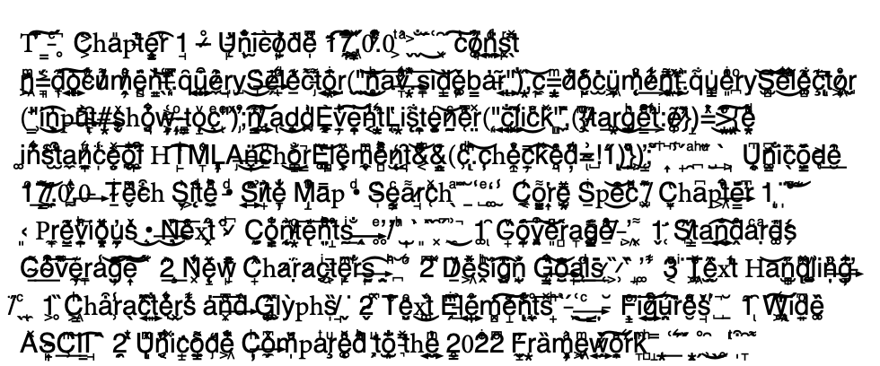
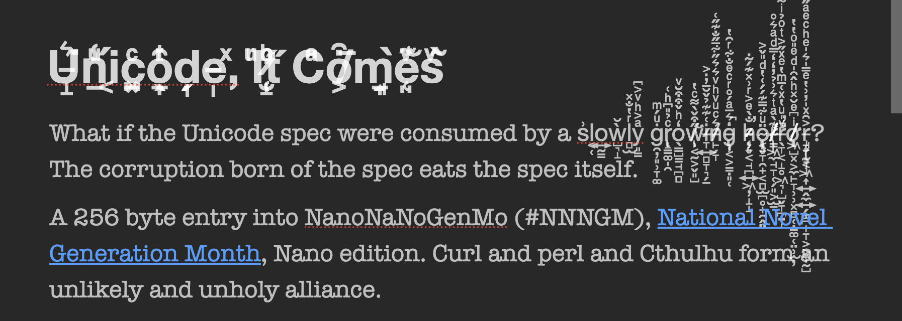

# U̶̝͛̇ṉͧ̾́i͔c͓̯̺ͨo̖̠͎ͬ̑ͭd̗̗ͅe̶ͅ,ͯ Iͧͬt̷̝̜̮̋ͨͪ C̎ͣo̸͕͒̄m͎̘̠̀e̜͈ͮ͊̆s̃ͮ̀

What if the Unicode spec were consumed by a s͗l͔̜o͍̰͇ẁ̺͉̝̆l̻̫ͬ̔̐̽y͈͇ͣ͐ͪͮ͐͆ ġ̯̦͈̹̞͚ͧ́ͫr̝̳͚̩̯ͨ̉̎͆ͪ͑ͅo̖̳̺͇̘̪̻̒ͪ̌͒͒̆ͮw̸̢̛̹͔̰͕̬͈̺̋͒̌̀͌ͨ̔i̶̷̞͍̻̞͉̗̠͑͊͊̉̌̆̄̓̇͐n̷̵̸̙̗̞͛ͨͧͮͪͮ͛͛̋͋̅̋̐͊̋͑ģ̶̡̣͔͕͇̣͈̜͛̅ͣ́̊ͬͨͤ̐͋ͬ̑̔̚ͅ h̷̵̴̷̨̨̦̬͔̘̪͍͖̦̝̝̐̀ͤ͐ͬ͗̽͊́̃̇̕ö̴̡̧͔̬̞̯̟͔̻̫̪̥̟̯̭̤ͧ͋̿͊́́͑̔ͩ̎̌͐ͅr̷̸̸̶̴̢̢̛͇͖̼̘̞̜̗͈͕̫̱͊̀ͣͭ͛͗̉̓̒̒̿ͩͣ͛̊r̶̛̖̞͔̝̥͖͉̩̺̬̞̪̤̝ͮ̍ͧ̔ͯ͑̄ͫ̔ͤͯ̋͐ͭͦ̉ͥ͌ͣ̉̚̕ơ̸̷̸̡͖̺͓͕̼̙̞̹̹͓̻̜̣̠͚̜̤̹̫̦ͥ͆ͤ̆̽ͪ̂̑̍ͩͤ̎ͦ̔̔ͅr̶̡̧̢̧̡̡̘̞̰͔͖͎͍̭̼͍̗͚̪̟̞͕͕̞̰̺͐̑ͯ̍̓͗̔ͤ̿̍͛̍ͤͪͨͤͣ̋? The corruption born of the spec eats the spec itself.

A 256 byte entry into [Nano-NaNoGenMo](https://nickm.com/post/2019/11/nano-nanogenmo-or-nnngm/) (#NNNGM), [National Novel Generation Month](https://nanogenmo.github.io), Nano edition. Curl and perl and Cthulhu form an unlikely and unholy alliance.

## The Competiton

NaNoGenMo is a generative riff on NaNoWriMo. The goal is to write code that generates a ‘novel’ (for some definition of the word, though some of them are, indeed, quite novel) of at least 50,000 words. The contest runs through the month of November each year. Entries are submitted as github issues on the [NaNoGenMo repo](https://github.com/NaNoGenMo) on Github.

## What it is

A shell script that uses curl to fetch each chapter of the latest version of the Unicode specification (Version 18 at the time of this writing) and then a heavily obfuscated bit of perl processes it into a dawning eldritch horror.

The novel is the Unicode Standard, the core specification. All 24 chapters are downloaded live from unicode.org, stripped down to their text, and then slowly consumed by combining diacritical marks. Chapter 1 is eminently readable, tricking the reader into a false sense of security. By Chapter 24, every letter is buried under accents, overlays and strikethroughs.

The idea came out of a bit of spec work I did for the Unicode cover contest in 2018. Fittingly, I’ve reused that work as the cover for this work.

## Where is it?

It’s a small (256 byte) script written mostly in perl, so it’s understandable you might miss it, or think your cat jumped on the keyboard and wrote some gibberish into a file. Rest assured that somehow, it actually *is* executable (if not exactly readable) perl code.

`curl -fL unicode.org/versions/latest/core-spec/chapter-\[1-24]|perl -CS -0pe's/<h(\d)/"#"x$1." $&"/ge;s#<m.*?j">|<(?!/[dfhlpt]).*?>##gs;s/(<.*?>\s*)+/\n/g;s/(.+\d)\n# /# $1: /g;s/&lt;/</g;s/&amp;/&/g;s/[^#\n]/$&.pack"U*",map{768+rand 99}1..rand$i++>>17/ge'`

“That’s pretty short and unreadable, but could it be even shorter and worser?”

I’m glad you asked! Depending on your interpretation of the NNNGM rules, the above can be compressed from 256 characters to 196 characters by packing the body of the perl script into double-byte unicode characters:

`curl -fL [unicode.org/versions/latest/core-spec/chapter-\[1-24]|perl](http://unicode.org/versions/latest/core-spec/chapter-%5C%5B1-24%5D%7Cperl) -CS -0pe'eval pack"n*",unpack"C0U*","猯㱨⡜搩⼢⌢砤ㄮ∠␦∯来㭳⌼洮⨿樢㹼㰨㼡⽛摦桬灴崩⸪㼾⌣杳㭳⼨㰮⨿㹜猪⤫⽜港朻猯⠮⭜搩屮⌠⼣․ㄺ 朻猯♬琻⼼⽧㭳⼦慭瀻⼦⽧㭳⽛帣屮崯␦⹰慣欢唪∬浡灻㜶㠫牡湤‹㥽ㄮ⹲慮搤椫⬾㸱㜯来"'`

Problem is, though it’s shorter in *characters*, it’s longer in *bytes* (374, versus 256)

This feels sneaky, though, and if it doesn’t violate the rules, it sure seems like it violates the *spirit* of the rules. Fittingly, it uses Unicode to codegolf an entry about corrupting the Unicode spec using a feature of Unicode.

## How do I run it?

```sh
sh zalgoplusplus.sh > unicode-it-comes.md
```

It needs `curl` and `perl`, both standard on macOS and most Linux systems,
and works in sh, bash and zsh. A run takes a little while, mostly spent
downloading. The output is Markdown: chapter titles, sections and
subsections are `#`, `##` and `###` headings, and the hashes themselves
are left uncorrupted so they still render.

## The novel

- [`unicode-it-comes.md`](unicode-it-comes.md): the generated Markdown,
  19 MB. Your viewer may struggle.
- [`unicode-18-it-comes.pdf`](unicode-18-it-comes.pdf): The book cover.
- [`unicode-18-it-comes.af`](unicode-18-it-comes.af): its Affinity source.

## How it works

Read right to left, more or less:

1. **Fetch.** `curl -fL 鈥�/chapter-\[1-24]` downloads all 24 chapter pages
   in one call, using curl’s own URL ranges. The `\[` keeps zsh from
   treating the range as a glob, and `-f` keeps any errors out of the book.
2. **Headings.** `s/<h(\d)/"#"x$1." $&"/ge` puts one `#` per heading level
   in front of each `<h1>`, `<h2>` and `<h3>`.
3. **Strip.** `s#<m.*?j">|<(?!/[dfhlpt]).*?>##gs` cuts each page’s scripts,
   styles and navigation (from the first `<meta>` to the chapter’s title
   block), along with every tag except the closing tags of block elements.
   `s/(<.*?>\s*)+/\n/g` then turns what’s left into line breaks.
4. **Chapter titles.** `s/(.+\d)\n# /# $1: /g` merges “Chapter 1” and 
   "# Introduction” into `# Chapter 1: Introduction`.
5. **Entities.** `&lt;` and `&amp;` become `<` and `&` again.
6. **It comes.** `s/[^#\n]/鈥�/ge` follows every character (except `#` and
   newline) with a random number of marks from U+0300 to U+0362, the
   Combining Diacritical Marks block. The maximum number of marks goes up
   by one every 131,072 characters (`rand$i++>>17`), so the corruption
   rises steadily through the book.

Commented, readable versions of every script are in
[`readable/`](readable/).

## Earlier versions

The entry started as a 255-character Python script and was golfed down
before the freed space was spent on headings, entities and the rising
corruption.

| File                                           | Size    | What it does                                                                               |
| ---------------------------------------------- | ------- | ------------------------------------------------------------------------------------------ |
| [`zalgo.py`](zalgo.py)                         | 255     | The original. Every tag becomes a space, so the pages’ CSS and JavaScript get zalgo’d too. |
| [`zalgo-golfed.py`](zalgo-golfed.py)           | 189     | Same output, golfed.                                                                       |
| [`zalgo-text.py`](zalgo-text.py)               | 255     | Only the spec’s text, with paragraph breaks.                                               |
| [`zalgo-text-golfed.py`](zalgo-text-golfed.py) | 239     | The same, golfed. Code samples keep their indentation.                                     |
| [`zalgo.sh`](zalgo.sh)                         | 177     | The same text again, in Perl, with a fixed `ord % 8` marks per character.                  |
| [`zalgoplusplus.sh`](zalgoplusplus.sh)         | **256** | The entry.                                                                                 |

## A note on fonts

Most terminal and editor fonts include only a few of the 112 combining
marks. When a letter carries marks its font doesn’t have, the system
draws the letter and its marks in a fallback font, so the letterforms
and spacing change from one character to the next. Fonts that cover the
whole block, like Menlo, SF Mono, DejaVu Sans Mono or Iosevka, give a
steadier texture. The flicker is a fitting side effect for a book about
Unicode.

## A note on markdown viewers and renderers

Some markdown viewers (and other text rendering environments) limit the overflow of a box, clipping the Zalgo in a disappointing way. In the extreme case, each line is its own box, clipping any combining characters that dare stray between lines. This is why I wasn’t able to make a satisfactory PDF version of the output. Boo.



MarkText seems to limit headings to their own bounding box, but leaves regular lines of text alone.



Other viewers (such as [Glow](https://github.com/charmbracelet/glow)) please Cthulhu.


## git blame

I, Kim Slawson, claim inspiration, authorship (and blame) for this work.

Find my other work at [https://slawson.org](https://slawson.org).

Catch me on [Mastodon](https://oldbytes.space/@0xC0FFEE) and [Bluesky](https://bsky.app/profile/0xc0ffee.bsky.social).
